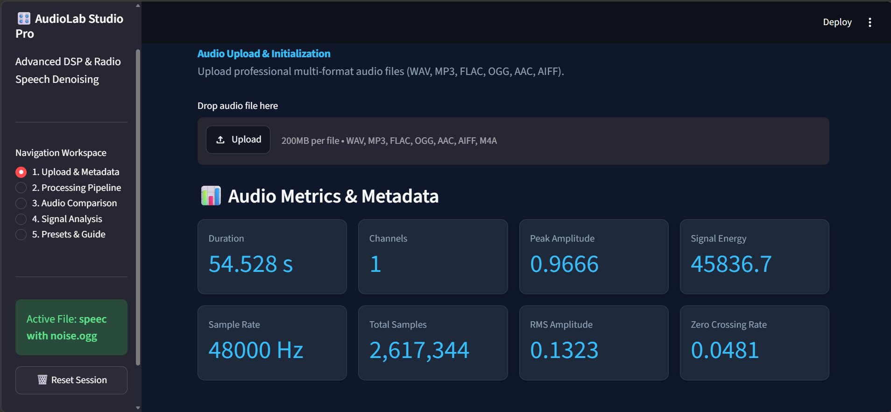
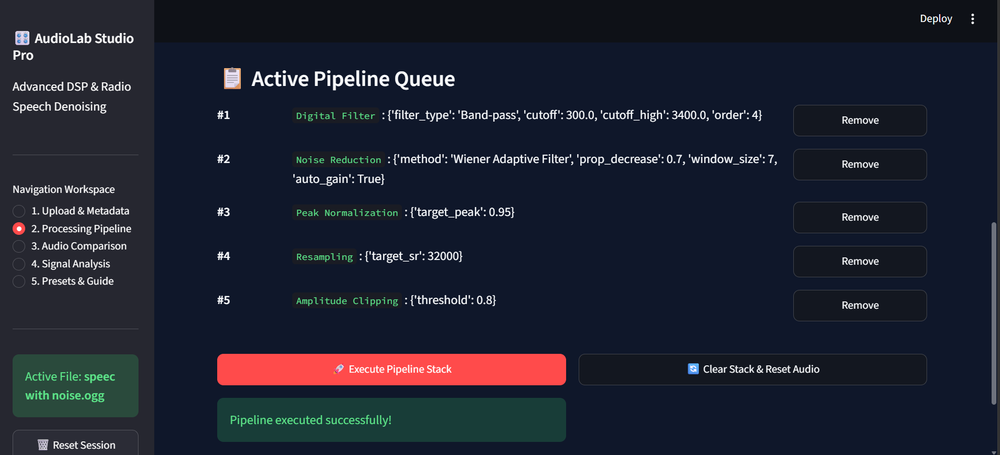
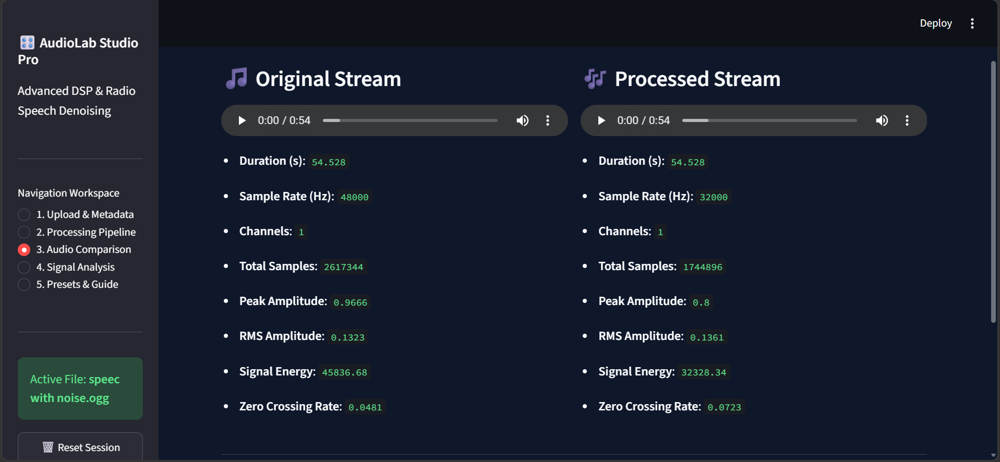
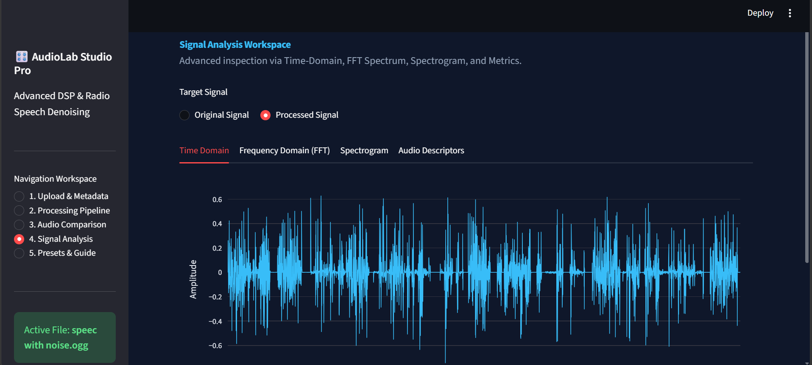

<div align="center">

# 🎧 AudioLab DSP Studio - Advanced

**A Modern, Interactive Web-Based Digital Signal Processing (DSP) & Speech Denoising Suite**

[](https://www.python.org/)
[](https://streamlit.io/)
[](https://scipy.org/)
[](https://librosa.org/)
[](https://plotly.com/)
[](LICENSE)

[Key Features](#-key-features) • [Installation](#-installation--setup) • [Usage Guide](#-quick-start--usage) • [Pipeline Architecture](#-dsp-pipeline-architecture) • [Screenshots](#-screenshots)

</div>

---

## 📌 Overview

**AudioLab DSP Studio - Advanced** is a state-of-the-art, interactive digital signal processing platform designed for audio engineers, data scientists, and speech researchers. Built with Python and Streamlit, it enables seamless multi-format audio uploading, interactive spectral analysis, real-time metric computation, and composable sequential DSP processing pipelines.

From adaptive speech denoising (via Wiener filters and stationary/non-stationary spectral gating) to high-precision Butterworth zero-phase filtering and dynamic auto-gain compensation, AudioLab Studio empowers users to manipulate and inspect audio signals with professional accuracy.

---

## ✨ Key Features

### 🎛️ 1. Audio Upload & Multi-Format Decoding
* **Wide Format Support**: Load `.wav`, `.mp3`, `.flac`, `.ogg`, `.aac`, `.aiff`, and `.m4a` files effortlessly.
* **Instant Metadata Analysis**: Automatically extract and compute critical audio metrics including **RMS Amplitude**, **Peak Amplitude**, **Zero Crossing Rate (ZCR)**, **Signal Energy**, **Channels**, and **Sample Rate**.

### 🔗 2. Composable DSP Pipeline Stack
Build custom audio processing pipelines sequentially by chaining various operations:
* **Adaptive Denoising**:
  * Wiener Adaptive Filtering (MMSE-based variance attenuation).
  * Spectral Gating (Stationary & Non-Stationary noise reduction powered by `noisereduce`).
  * Moving Average & Median Filtering.
* **Digital Filtering**: High-pass, Low-pass, Band-pass, and Band-stop zero-phase Butterworth filters (`sosfiltfilt`) to prevent phase distortion.
* **Dynamic Range & Gain**: Peak Normalization, Gain Adjustment (dB), and Amplitude Clipping.
* **Time & Envelopes**: Fade-In / Fade-Out envelope editing and Time Reversal.
* **Utility Operations**: Polyphase Resampling (anti-aliased), DC Offset Removal, and Mono/Stereo Spatial Conversion.
* **Auto-Gain Compensation**: Intelligent volume recovery after heavy noise suppression.

### 🔬 3. Interactive Signal Analysis Suite
Leverage interactive, hardware-accelerated Plotly visualizations:
* **Time-Domain Waveforms**: Downsampled interactive wave plots.
* **Frequency-Domain (FFT)**: Fast Fourier Transform spectrum magnitude plots.
* **Spectrograms**: High-resolution STFT Short-Time Fourier Transform visualizer utilizing Turbo colormaps.
* **Audio Descriptors**: Quantitative metrics including **Spectral Centroid**, **Spectral Bandwidth**, and **Spectral Flatness**.

### ⚡ 4. Engineering Presets & Audio Export
* **One-Click Presets**:
  * *Voice Clarity*: High-pass filter combined with peak normalization.
  * *Speech Prep*: Low-pass anti-aliasing filter with 16kHz resampling.
  * *Heavy Radio Denoise*: Band-pass speech filtering, Wiener noise reduction, and gain compensation.
* **Lossless Export**: Download the processed result as high-fidelity WAV files.

---

## 🏗️ DSP Pipeline Architecture

```
                                  ┌────────────────────────┐
                                  │   Raw Audio Input      │
                                  └───────────┬────────────┘
                                              │
                                              ▼
                                 ┌──────────────────────────┐
                                 │ Metadata & Metric Engine │
                                 └───────────┬──────────────┘
                                              │
                                              ▼
                             ┌──────────────────────────────────┐
                             │    Composable DSP Stack Queue    │
                             │  (Denoise, Filter, Gain, etc.)   │
                             └───────────────┬──────────────────┘
                                              │
                                              ▼
                                 ┌──────────────────────────┐
                                 │   SOS Zero-Phase Exec    │
                                 └───────────┬──────────────┘
                                              │
                                              ▼
                                 ┌──────────────────────────┐
                                 │ Auto-Gain Compensation   │
                                 └───────────┬──────────────┘
                                              │
          ┌──────────────────────────────────┴──────────────────────────────────┐
          ▼                                                                     ▼
┌──────────────────┐                                                  ┌──────────────────┐
│ Interactive FFT  │                                                  │ Audio Player &   │
│   & Spectrogram  │                                                  │  WAV Downloader  │
└──────────────────┘                                                  └──────────────────┘
```

---

## 🛠️ Technology Stack

* **Frontend & Framework**: [Streamlit](https://streamlit.io/) (Custom CSS Dark Theme)
* **Digital Signal Processing**: [SciPy](https://scipy.org/) (`scipy.signal`, `scipy.fft`), [Librosa](https://librosa.org/), [Noisereduce](https://github.com/tobybreckon/noisereduce)
* **Audio I/O & Decoding**: [SoundFile](https://python-soundfile.readthedocs.io/), [Librosa](https://librosa.org/), [FFmpeg](https://ffmpeg.org/)
* **Visualization**: [Plotly](https://plotly.com/python/) (Interactive Scatter & Heatmaps), [NumPy](https://numpy.org/), [Pandas](https://pandas.pydata.org/)

---

## 💻 Installation & Setup

### Prerequisites
* **Python**: `3.9` or higher installed.
* **FFmpeg** *(Optional, recommended for `.m4a` & `.aac` format decoding)*:
  * **macOS**: `brew install ffmpeg`
  * **Ubuntu/Debian**: `sudo apt update && sudo apt install ffmpeg`
  * **Windows**: Download binaries or install via `winget install ffmpeg`.

### Step-by-Step Installation

1. **Clone the repository:**
   ```bash
   git clone https://github.com/your-username/audiolab-dsp-studio.git
   cd audiolab-dsp-studio
   ```

2. **Create and activate a virtual environment:**
   * **Linux/macOS:**
     ```bash
     python3 -m venv venv
     source venv/bin/activate
     ```
   * **Windows:**
     ```bash
     python -m venv venv
     venv\Scripts\activate
     ```

3. **Install required dependencies:**
   ```bash
   pip install -r requirements.txt
   ```

4. **Launch the Streamlit application:**
   ```bash
   streamlit run app.py
   ```

5. Open your web browser and navigate to `http://localhost:8501`.

---

## 📋 Requirements (`requirements.txt`)

Ensure your environment includes the following key packages:

```text
streamlit>=1.30.0
numpy>=1.24.0
pandas>=2.0.0
scipy>=1.10.0
soundfile>=0.12.1
librosa>=0.10.0
plotly>=5.15.0
noisereduce>=3.0.0
```

---

## 📸 Screenshots

> *Tip: Replace the placeholder image paths below with actual screenshot links or uploaded assets from your GitHub repo.*

| 1. Upload & Metadata Engine | 2. Sequential DSP Pipeline Stack |
| :---: | :---: |
|  |  |

| 3. Audio Comparison (Before vs After) | 4. Spectrogram & Signal Analysis |
| :---: | :---: |
|  |  |

---

## 🚀 Quick Start & Usage

1. **Upload Audio**: Go to `1. Upload & Metadata` in the sidebar and upload any audio file.
2. **Configure Operations**: Move to `2. Processing Pipeline`, choose a DSP filter or denoising method, adjust sliders/parameters, and click **Add to Pipeline Stack**.
3. **Execute Sequence**: Click **🚀 Execute Pipeline Stack** to process the audio through zero-phase digital filtering.
4. **Compare Outputs**: Go to `3. Audio Comparison` to listen to original vs processed audio side by side.
5. **Inspect Signals**: Open `4. Signal Analysis` to visualize Time-Domain waveforms, FFT magnitudes, and STFT Spectrograms.
6. **Download Output**: Export the enhanced audio stream directly to `.wav` format.

---

## 📄 License

Distributed under the **MIT License**. See [`LICENSE`](LICENSE) for more information.

---

<div align="center">

Made with ❤️ for Audio Signal Processing & Speech Enhancement Research.

</div>
